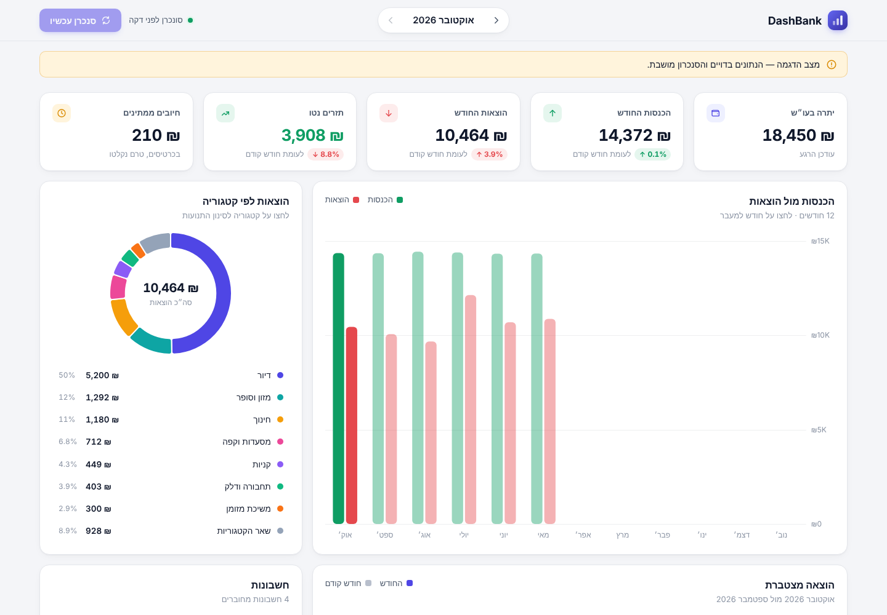
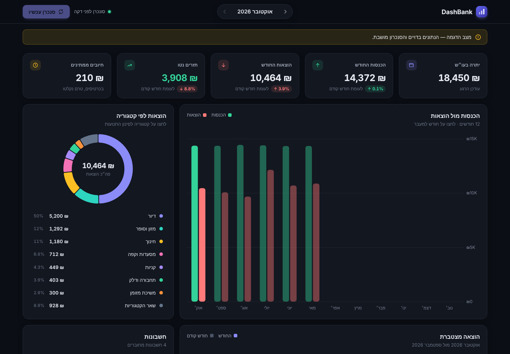
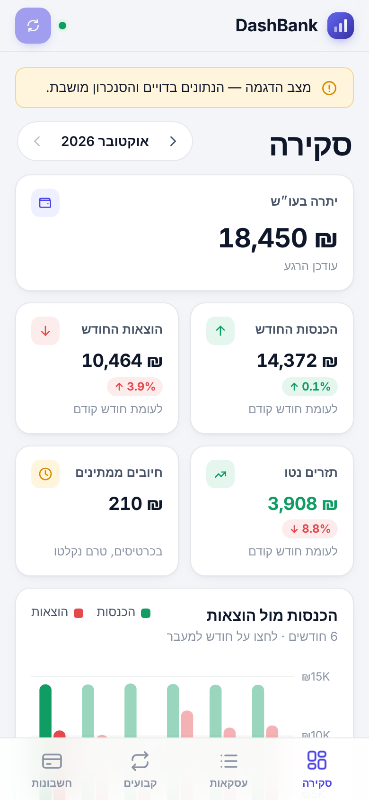
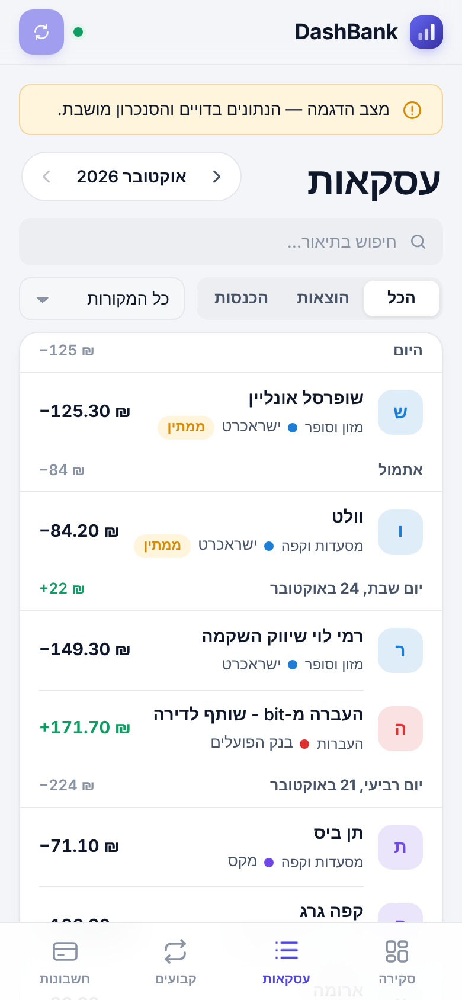
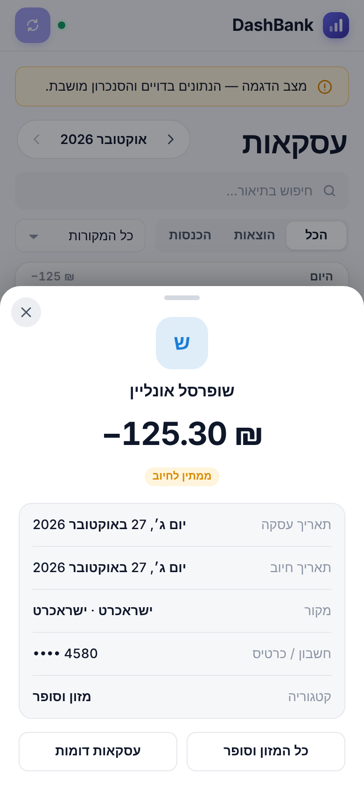
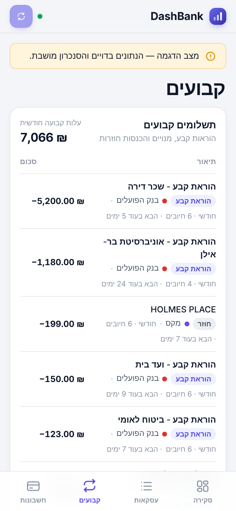
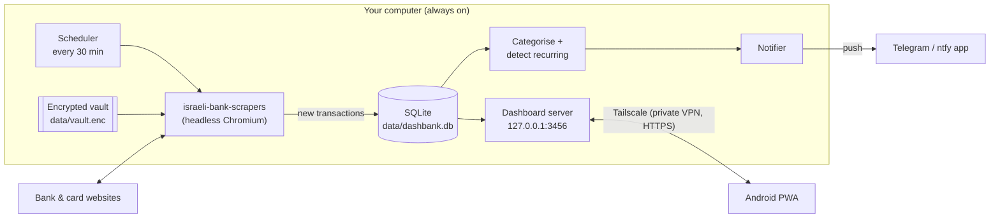

<div align="center">

# DashBank

**Self-hosted finance tracker for Israeli bank accounts and credit cards: one dashboard, plus a phone alert for every charge.**

[](https://github.com/Yair-fr/DashBank/actions/workflows/ci.yml)




</div>

---

## Contents
- [What it does](#what-it-does)
- [Screenshots](#screenshots)
- [How it works](#how-it-works)
- [Prerequisites and assumptions](#prerequisites-and-assumptions)
- [Quick start (demo, 2 minutes)](#quick-start-demo-2-minutes)
- [Installation](#installation)
- [Daily use](#daily-use)
- [Phone access (Android app)](#phone-access-android-app)
- [Configuration reference](#configuration-reference)
- [Deployment options](#deployment-options)
- [Security model](#security-model)
- [Troubleshooting](#troubleshooting)
- [Limitations](#limitations)
- [Legal and compliance](#legal-and-compliance)
- [Development](#development)

---

## What it does

| | |
|---|---|
| **Aggregates** | Bank Hapoalim, Isracard, Cal (Visa Cal) and Max. Leumi, Discount, Mizrahi-Tefahot, Amex and the other institutions supported by [`israeli-bank-scrapers`](https://github.com/eshaham/israeli-bank-scrapers) work too. |
| **Alerts** | A Telegram and/or ntfy push notification for every new charge or deposit. The first sync sends one summary instead of hundreds of messages. |
| **Visualises** | Balance, monthly income/expense/net with month-over-month change, a 12-month trend, category breakdown, cumulative daily spend, and a searchable transaction list. |
| **Detects** | Standing orders, subscriptions and recurring income, with the next expected charge date and your fixed monthly cost. |
| **Avoids double counting** | Card-bill settlements in the bank account are excluded from spending, because each purchase is already counted on the card. |
| **Runs anywhere you own** | A Windows/macOS/Linux PC with auto-start, or Docker on a home server or Raspberry Pi. It installs on Android as an app and works offline. |
| **Keeps data local** | Credentials are AES-256-GCM encrypted. Data lives in a local SQLite file. The server listens on `127.0.0.1` only. |

## Screenshots

| Desktop (dark) | Mobile overview | Transactions | Transaction detail | Standing orders |
|---|---|---|---|---|
|  |  |  |  |  |

> All screenshots use the built-in demo dataset (`npm run demo`) and contain no real data. Regenerate them with `npm run screenshots`.

## How it works



1. On a schedule, DashBank logs in to each institution's website with **your own credentials**, exactly as you would in a browser. There is no public banking API for consumers in Israel.
2. Transactions are normalised and de-duplicated with a content hash. A pending transaction that later settles updates in place.
3. New rows are categorised by Hebrew/English merchant keywords, and recurring patterns are re-detected.
4. Each new row triggers a notification. The dashboard reads the same database.

## Prerequisites and assumptions

### You need

| Requirement | Why | Notes |
|---|---|---|
| **Node.js ≥ 22.22.2** | Runtime. Uses the built-in `node:sqlite` module. Required by `israeli-bank-scrapers` | [nodejs.org](https://nodejs.org) LTS |
| **A computer that stays on** | Syncs happen only while DashBank runs | A desktop, an always-on laptop, or a home server/Pi with Docker |
| **Online-banking credentials** for each institution | DashBank logs in on your behalf | Hapoalim: user code + password. Isracard: ID + last 6 card digits + password. Cal / Max: username + password |
| **~500 MB disk** | Chromium (downloaded automatically by `npm install`) plus data | |
| **Telegram** and/or **ntfy** on your phone | Push notifications | Both are free |
| **Tailscale** (optional) | Secure phone access to the dashboard | Free for personal use |

### Assumptions this project makes
- **Single owner.** One person tracks their own accounts. It is not a multi-tenant service.
- **Near-real-time, not real-time.** Alerts arrive after the next sync (default every 30 minutes). Card issuers sometimes publish a charge hours after the swipe. If you need instant alerts at the point of sale, your card issuer's own app is faster.
- **No two-factor SMS logins.** Institutions that demand an SMS code on every login can't be synced unattended. Hapoalim, Isracard, Cal and Max currently work with password-only logins (this can change).
- **Website changes break scrapers.** When a bank redesigns its site, syncing that institution fails until `israeli-bank-scrapers` publishes an update (`npm update israeli-bank-scrapers`).
- **Amounts in ILS.** Foreign-currency purchases are shown in their original currency too, but totals use the charged ILS amount.
- **Israel time zone** (`Asia/Jerusalem`) for dates and notifications.

## Quick start (demo, 2 minutes)

Try the full interface with realistic fake data. No credentials needed.

```bash
git clone https://github.com/Yair-fr/DashBank.git
cd DashBank
npm install
npm run demo
```

Open **http://127.0.0.1:3456**. The demo database is rebuilt on every start and nothing is sent anywhere.

## Installation

### 1. Install
```bash
git clone https://github.com/Yair-fr/DashBank.git
cd DashBank
npm install
cp .env.example .env          # Windows: copy .env.example .env
```

### 2. Set up phone notifications
<details open>
<summary><b>Telegram (recommended)</b></summary>

1. In Telegram, message **@BotFather**, send `/newbot`, and copy the **bot token**.
2. Send any message to your new bot. Bots can't message you first.
3. Message **@userinfobot** to get your numeric **chat id**.
4. In `.env`, set `TELEGRAM_BOT_TOKEN` and `TELEGRAM_CHAT_ID`.
</details>

<details>
<summary><b>ntfy (alternative or additional)</b></summary>

1. Install [ntfy for Android](https://play.google.com/store/apps/details?id=io.heckel.ntfy).
2. Pick a **long random topic name**, for example `dashbank-` followed by 20 random characters, and subscribe to it in the app.
3. In `.env`, set `NTFY_TOPIC`. Optionally set `NTFY_TOKEN` for an access-controlled server.

> ⚠️ Anyone who knows a topic name on the public `ntfy.sh` server can read its messages. Use a long random name, an access token, or a self-hosted ntfy server.
</details>

Verify:
```bash
npm run test-notify
```
A sample "💳 ₪123.45 · בדיקת התראה" (test notification) message should arrive on your phone, and the command prints which channels succeeded.

### 3. Add your accounts to the encrypted vault
```bash
npm run setup
```
- First you choose a **vault passphrase**. It encrypts your banking credentials (AES-256-GCM, scrypt key derivation). **If you lose it, you have to delete the vault and re-enter everything.**
- Add one entry per institution. Password fields are hidden as you type.

### 4. Run
```bash
npm start
```
On first start DashBank asks for the vault passphrase, then:
- Downloads up to 6 months of history (`MONTHS_BACK`). This can take a few minutes per institution.
- Sends **one summary notification** per institution.
- From then on, syncs every 30 minutes and notifies you about each new transaction.

Open **http://127.0.0.1:3456**.

### 5. (Optional) Start automatically at login
```bash
npm run autostart              # Windows Task Scheduler / macOS LaunchAgent / Linux systemd --user
npm run autostart -- --remove  # undo
```
Unattended start needs `DASHBANK_PASSPHRASE` in `.env`, because nobody is there to type it. Only do this on a computer used by you alone, with full-disk encryption on (BitLocker or FileVault).

## Daily use

| Task | How |
|---|---|
| See this month at a glance | **Overview** tab: balance, income, expenses, net, pending card charges |
| Browse another month | The ‹ › arrows next to the month name |
| Find a transaction | **Transactions** tab: search by text, filter by income/expense/source |
| Drill into a category | Click a slice in the category chart to filter the transaction list |
| See details of a charge | Tap a transaction to open its detail sheet (date, charge date, card, installments, original currency) |
| Review fixed costs | **Recurring** tab: standing orders, subscriptions, recurring income, and the next expected date |
| Sync immediately | The **Sync now** button, or pull down to refresh on mobile |
| One-off sync from the terminal | `npm run sync` |

### Commands

| Command | Purpose |
|---|---|
| `npm run demo` | Dashboard with generated demo data |
| `npm run setup` | Add, list or remove institutions in the encrypted vault |
| `npm start` | Dashboard + scheduled sync + notifications |
| `npm run sync` | Sync once and exit |
| `npm run test-notify` | Send a test notification |
| `npm run autostart` | Start at login (`-- --remove` to undo) |
| `npm run auth-setup` | Create the dashboard login (password + authenticator app) |
| `npm run screenshots` | Regenerate `docs/screenshots/` (requires Playwright) |
| `npm test` | Run the test suite |

## Phone access (Android app)

The server deliberately listens on `127.0.0.1` only. To reach it from your phone **without exposing it to the internet**, use [Tailscale](https://tailscale.com), a free WireGuard-based private network between your own devices.

1. Install Tailscale on the computer and on the phone ([Google Play](https://play.google.com/store/apps/details?id=com.tailscale.ipn)), and sign in with the same account on both.
2. In the Tailscale admin console, under **DNS**, enable **MagicDNS** and **HTTPS Certificates**.
3. On the computer:
   ```bash
   tailscale serve --bg 3456
   ```
   It prints your private HTTPS address, for example `https://my-pc.tail1234.ts.net`.
4. On the phone, open that address in Chrome, then choose **⋮ → Install app**.

You get a home-screen icon and a full-screen app with a bottom tab bar, pull-to-refresh and dark mode. When you're offline it shows the most recent data.

## Configuration reference

All settings live in `.env`. See `.env.example`.

| Variable | Default | Description |
|---|---|---|
| `PORT` | `3456` | Dashboard port |
| `SYNC_INTERVAL_MINUTES` | `30` | Minutes between syncs (minimum 10, to stay polite to the banks) |
| `MONTHS_BACK` | `6` | History loaded on an institution's first sync (1–12) |
| `NOTIFY_MIN_AMOUNT` | `0` | Only alert for charges at or above this amount (ILS) |
| `DASHBANK_PASSPHRASE` | *(empty)* | Vault passphrase. If empty, you are prompted at start |
| `TELEGRAM_BOT_TOKEN` / `TELEGRAM_CHAT_ID` | | Telegram channel |
| `NTFY_SERVER` / `NTFY_TOPIC` / `NTFY_TOKEN` | `https://ntfy.sh` | ntfy channel |
| `AUTH_SECRET` | | 64-hex-character secret that signs login sessions |
| `PUBLIC_URL` | | Your Tailscale HTTPS URL (needed for Google sign-in) |
| `GOOGLE_CLIENT_ID` / `GOOGLE_CLIENT_SECRET` / `AUTH_ALLOWED_EMAILS` | | Optional Google sign-in, restricted to the listed emails |
| `HOST` | `127.0.0.1` | Bind address. Change it only inside Docker |

## Deployment options

| Option | Best for | Steps |
|---|---|---|
| **PC + auto-start** | Most people | [Installation](#installation), then `npm run autostart` |
| **Docker** | Home server, NAS, Raspberry Pi (arm64) | See below |

```bash
cp .env.example .env                                     # include DASHBANK_PASSPHRASE
docker compose run --rm dashbank node scripts/setup.js   # add institutions
docker compose up -d
tailscale serve --bg 3456                                # phone access
```
The container publishes the port on the host's loopback only (`127.0.0.1:3456`). It ships with system Chromium and Hebrew fonts and keeps its data in `./data`.

## Security model

| Threat | Mitigation |
|---|---|
| Credentials stolen from disk | AES-256-GCM vault with a scrypt-derived key (N=2¹⁵). File mode `0600`. Atomic writes |
| Credentials leaking into logs or alerts | Structured logger never receives credentials. Scraper errors are scrubbed of credential values |
| Dashboard reachable from the network | Binds `127.0.0.1`. Remote access only through Tailscale (device-authenticated WireGuard) |
| Unauthorised dashboard access | Password (scrypt) + TOTP authenticator codes with replay protection, single-use recovery codes, rate limiting, signed `HttpOnly; SameSite=Strict` session cookies, CSRF header check. Optional Google sign-in validates the ID-token signature, audience, nonce and an email allow-list |
| XSS / clickjacking | Strict Content-Security-Policy, `X-Frame-Options: DENY`. All data is rendered through `textContent` |
| Third-party exposure | Only notification text leaves your machine, via Telegram and/or ntfy |

**Your responsibilities:** full-disk encryption, an OS login password, keeping `.env` private, and backing up `data/` securely.

## Troubleshooting

| Symptom | Fix |
|---|---|
| `סיסמת כספת שגויה או קובץ פגום` (wrong vault passphrase or corrupted file) | Wrong passphrase. If it's lost, delete `data/vault.enc` and run `npm run setup` again |
| Sync fails with `INVALID_PASSWORD` | Your bank password changed. Update it with `npm run setup` |
| `CHANGE_PASSWORD` / `ACCOUNT_BLOCKED` | Log in to the institution's website manually once and complete the prompt shown there |
| `TIMEOUT` or repeated generic errors | The website is slow or was redesigned. Run `npm update israeli-bank-scrapers`. A failure screenshot is saved in `data/failures/` |
| No notifications | Run `npm run test-notify` and check the token, chat id and topic |
| The phone shows an old version | Close and reopen the app. The service worker updates in the background |
| `Cannot find module 'node:sqlite'` or `EBADENGINE` warning | Upgrade Node.js to 22.22.2 or later (`node -v`) |

## Limitations
- Polling-based. See the [assumptions](#assumptions-this-project-makes) above.
- Institutions that require SMS OTP on every login can't be synced unattended.
- Categorisation is keyword-based and covers common Israeli merchants. Anything unmatched is shown as *Other*.
- The service worker requires HTTPS on the phone (provided by `tailscale serve`).

## Legal and compliance

> **Read before connecting real accounts.** This is not legal or financial advice.

- **Bank terms of service.** Automated login with your own credentials (screen scraping) may breach your bank's or card issuer's online-service terms. For personal use, that is a risk you accept knowingly.
- **Do not offer DashBank as a service to others.** Operating it for other people's accounts makes you a database controller under the Israeli Privacy Protection Law (Amendment 13), and may require a licence under the Financial Information Service Law, 5782-2021. Use a licensed Open Banking provider for any commercial version.
- **Third parties.** Notification contents pass through Telegram and/or ntfy.
- **Accessibility.** The UI targets WCAG 2.1 AA. Israeli accessibility regulations (IS 5568) apply when the service is offered to the public.
- Full analysis: [`docs/legal/compliance-check.md`](docs/legal/compliance-check.md).

Provided **as-is, without warranty**.

## Development

```bash
npm test                 # node:test suite; no network access, scrapers and HTTP are faked
npm run demo             # manual UI testing
npm run screenshots      # visual check across desktop/mobile/light/dark
```

```
src/
  index.js          entry point: server + scheduler + sync
  sync.js           orchestration: scrape → normalise → store → categorise → notify
  scraper.js        israeli-bank-scrapers wrapper (timeouts, isolated failures, redaction)
  db.js             SQLite store (node:sqlite), de-duplication, aggregates
  normalize.js      transaction normalisation + content hash
  categorize.js     keyword categoriser (Hebrew + English)
  recurring.js      standing order / subscription detection
  vault.js          encrypted credential vault
  notify/           Telegram, ntfy, message formatting
  auth/             password, TOTP, sessions, Google OIDC, rate limiting
  server.js         Express API + static PWA
  demo.js           deterministic demo dataset
public/             dashboard PWA (vanilla JS, Chart.js, service worker)
scripts/            setup, auth-setup, test-notify, autostart, screenshots
tests/              node:test suites
docs/               design spec, implementation plan, compliance check, screenshots
```

**Stack:** Node.js 22 (ESM, `node:sqlite`, `node:test`, `node:crypto`) · Express 5 · Chart.js 4 · node-cron · israeli-bank-scrapers. No front-end build step and no native modules.

### Status
| Area | State |
|---|---|
| Sync, storage, categories, recurring detection, notifications | ✅ Done |
| Dashboard + Android PWA (offline, dark mode, motion) | ✅ Done |
| Sign-in backend (password + TOTP, Google OIDC) | ✅ Done, 🔄 connecting to the UI |
| English / Hebrew UI, WCAG 2.1 AA, in-app legal pages, CSV export | 🔄 In progress |

---

<sub>© DashBank. All rights reserved. Not affiliated with any bank or card issuer. Bank and card names are trademarks of their respective owners.</sub>
